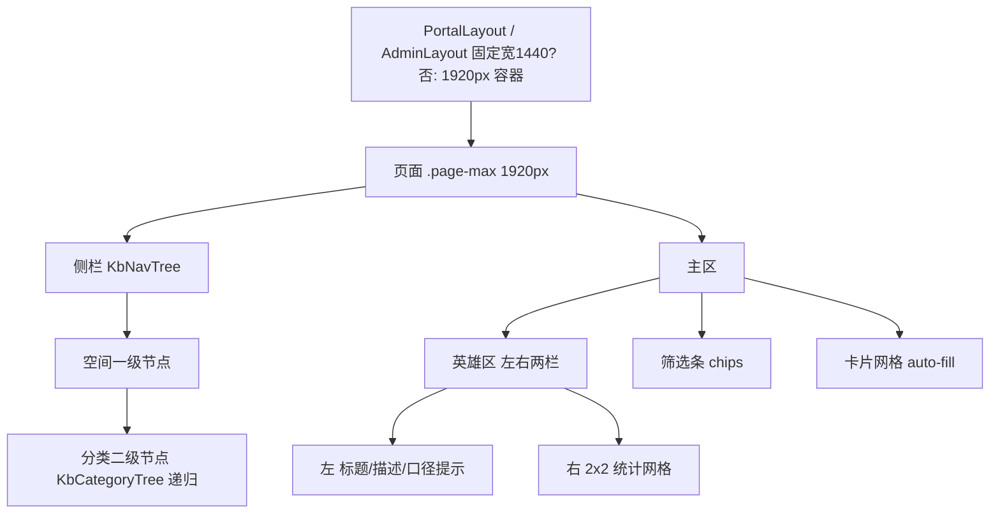

## 产品概述

INUWIKI 知识库前端在完成 1920px 铺满改造后暴露出排版问题：侧栏空间切换器被挤在 248px 宽度内导致菜单错乱、英雄区统计大片留白、后台筛选入口重复。本次对全部页面做视觉重构，在保留蓝色品牌体系与既有功能口径的前提下，统一导航语言、提升宽屏信息密度。

## 核心功能

- **统一侧栏导航树**：空间作为一级节点、分类作为二级节点，合并为一棵可展开/收起的树，统一 `.tree-item` 视觉语言，带文章数、当前项高亮、受限空间带锁标，不再出现胶囊分段器与名称截断
- **英雄区左右两栏**：左侧标题+描述+统计口径提示，右侧 4 个统计数字排成 2×2 网格占满右半区，消除大片留白
- **后台列表页去重**：删除工具栏中与侧栏重复的空间下拉，保留侧栏单一入口；工具栏筛选控件重新分组
- **详情页重排**：1920 宽下主列加宽后的标题、元信息、目录、附件区重新组织
- **编辑页重排**：设置页签的多张纵向卡片改为信息密度更高的分区布局，授权面板由"手填 ID"改为更规整的表单行
- **空间管理页与登录页同步统一视觉语言**

## 技术栈

- 框架：Vue 3.5 + TypeScript + Vite 5（现有）
- 样式：全局 `src/styles/design.css` 设计令牌体系 + Tailwind 实用类（现有）
- 组件库：Element Plus（现有，`el-drawer` / `el-pagination` / `el-dropdown` / `el-message`）
- 校验门禁：`npm run build`（`vue-tsc -b && vite build`，基线 exitCode 0）

## 现状与痛点（已核实）

| 位置 | 问题 |
| --- | --- |
| `components/KbSpaceSwitcher.vue:22-44` | `.space-switch` 横向胶囊 + `min-width: calc(50% - 3px)` 被塞进 248px 侧栏，空间名 truncate；**仅 `portal/WikiList.vue:164` 一处引用，可直接替换** |
| `portal/WikiList.vue:161-171` | 侧栏同时存在胶囊控件与 `.tree-item` 列表，两套视觉语言 |
| `admin/WikiList.vue:241-245` | 工具栏空间 `<select>` 与 `:197-231` 侧栏空间列表重复（侧栏树在 `:226` 用 `KbCategoryTree`） |
| `design.css:234-248` | `.hero-stats` 为 `flex; gap:32px`，1592px 容器内仅占左侧一小段 |
| `admin/WikiEdit.vue:443-569` | 4 张 `.card-solid` 纵向堆叠、行内 `style` 泛滥；授权区一行塞 select+2 input |
| `admin/SpaceManage.vue:264-308` | 空间复用文章卡片 `.kb-card` + 16:9 `.cover`，6 列后每张仅 296px |


## 实现方案

### 1. 统一导航树（核心重构）

新建 `components/KbNavTree.vue`，替代门户侧栏的 `KbSpaceSwitcher` + `KbCategoryTree` 组合：

- 一级节点＝空间（`allow-all` 时首项为"全部空间"），可展开/收起；二级节点＝该空间下分类（复用 `KbCategoryTree` 的递归渲染）
- 统一走 `.tree-item` 样式，新增 `.tree-space`（一级）与 `.tree-child`（缩进）区分层级
- 受限空间一级节点渲染 `Lock` 图标；文章数沿用现有 `.count`
- 交互：点击一级节点＝切换空间并自动展开；点击二级＝切换分类。两者互斥高亮
- 后台列表页复用同一组件，移除 `admin/WikiList.vue:241-245` 的重复空间下拉，`spaceSelect` 状态改为直接绑定 `spaceId`

数据侧无需改动：`useWikiStore` 已有 `spaces` / `categories[spaceId]` / `adminSpaces` 缓存，切换空间时沿用现有 `watch(spaceId)` 触发 `loadCategories` + `fetchArticles` 链路。

### 2. 英雄区左右两栏

```css
.hero { display: grid; grid-template-columns: minmax(0, 1fr) auto; gap: 32px; align-items: center; }
.hero-stats { display: grid; grid-template-columns: repeat(2, minmax(120px, 1fr)); gap: 16px 32px; }
```

左侧放标题+描述+`.stat-note`，右侧 2×2 统计网格；保留 `.hero::after` 装饰圆与 `.hero-stats` 的 `z-index: 1`（防止被遮盖，这是已知坑）。窄屏用 `@media (max-width: 1100px)` 回落为单列堆叠。

### 3. 各页面重排要点

- **门户列表**：chips 筛选条与"仅当前页生效"提示合并为一行；卡片网格沿用已改好的自适应列；空态/分页统一
- **后台列表**：工具栏按"搜索 | 分类/状态下拉 | 右侧新建"三段分组；`statusbar` 存储条改为与表格同宽的顶部摘要条
- **详情页**：`detail-grid`（`1fr 268px`）已验证可用，重排重点为元信息排版、附件卡片长宽比、上下篇按钮；保持 `.article-body` 880px / `.kb-player` 1200px 限宽不回退
- **编辑页**：设置页签由 4 张堆叠卡改为单一容器的分区（基础信息 / 发布设置 / 可见范围 / 可编辑范围），行内 `margin-top` 抽成 `.form-section` 类；授权面板改用规整的表单行 + 已授权标签列表
- **空间管理**：空间卡片从文章卡片复用改为专用的紧凑信息卡（去掉 16:9 封面占位，改用左侧色条 + 名称/编码/篇数/成员数），抽屉宽度由 640px 提升到 720px
- **登录页**：保留 400px 亚克力卡片，统一品牌标题层级与输入框焦点态；不做大改

## 实施要点（防回归）

- **只动尺寸与结构类 CSS，不改配色/圆角/阴影令牌**，品牌蓝 `#2B5CE6` 体系保持不变
- 必须回归验证三项既有成果：`.page-max` 1920px 铺满、`.grid` 自适应列数、正文 880px / 播放器 1200px 限宽
- 功能约束不可破：受限空间对未授权成员完全不可见；统计口径 Option A（受限空间不计入全站统计）的 `.stat-note` 提示文案必须保留
- 新增样式一律写入 `design.css`（全局），不要写在 `WikiDetail.vue` 的 `<style scoped>`——`.article-body` 是在子组件 `KbContentRenderer` 中渲染的，scoped 样式不生效
- `KbSpaceSwitcher.vue` 确认仅一处引用，替换后可删除；删除前二次确认无残留 import

## 架构设计



## 目录结构

```
INUWIKI/frontend/src/
├── components/
│   ├── KbNavTree.vue             # [NEW] 统一导航树（空间一级/分类二级），替换门户侧栏的 KbSpaceSwitcher+KbCategoryTree 组合，并供后台列表页复用
│   ├── KbSpaceSwitcher.vue       # [DELETE] 胶囊分段器已被 KbNavTree 取代，确认 portal/WikiList.vue:164 为唯一引用后删除组件与 import
│   ├── KbCategoryTree.vue        # [MODIFY] 保持递归能力，配合 KbNavTree 作为二级渲染；现有 portal:168 / admin:226 两处调用需同步调整
│   └── KbArticleCard.vue         # [MODIFY] 适配宽屏卡片密度（标题/摘要行数与封面比例微调）
├── styles/
│   └── design.css                # [MODIFY] 核心。.hero 改 grid 左右两栏；.hero-stats 改 2x2 网格；新增 .tree-space / .form-section；调 .statusbar、.kb-card 比例；保留并勿回退 --page-max/--read-max/--page-pad 令牌与 .grid auto-fill
├── views/
│   ├── portal/WikiList.vue       # [MODIFY] 侧栏换 KbNavTree；英雄区改左右两栏结构；chips 与提示合并；保留 Option A 口径文案
│   ├── portal/WikiDetail.vue     # [MODIFY] 主列加宽后的元信息/附件/上下篇重排；保持 880px/1200px 限宽
│   ├── admin/WikiList.vue        # [MODIFY] 移除 :241-245 重复空间下拉（spaceSelect→spaceId）；工具栏三段分组；statusbar 改顶部摘要条
│   ├── admin/WikiEdit.vue        # [MODIFY] 4 张堆叠卡改 .form-section 分区；授权面板表单行化；清理行内 style
│   ├── admin/SpaceManage.vue     # [MODIFY] 空间改专用紧凑信息卡；抽屉 640px→720px
│   └── Login.vue                 # [MODIFY] 标题层级与输入焦点态统一，结构基本不变
└── layout/
    ├── PortalLayout.vue          # 只读复核：确认顶栏对齐不受侧栏重构影响
    └── AdminLayout.vue           # 只读复核：保持已移除 px-7 的状态
```

## 设计风格

沿用现有 Fluent Design 亚克力风格与品牌蓝体系，不推翻重来，只提升宽屏下的信息密度与导航一致性。保持 `--grad-primary` 渐变、`backdrop-filter` 毛玻璃、分层阴影 `--sh-1/2/3` 的既有质感。

## 页面规划

1. **门户列表页**：侧栏统一导航树（左）+ 英雄区左右两栏 + 筛选条 + 自适应卡片网格
2. **后台知识管理页**：同一套导航树 + 三段式工具栏 + 数据表格 + 顶部摘要条
3. **知识详情页**：面包屑 + 居中正文 + 右侧目录 + 附件区
4. **文章编辑页**：设置/正文双页签 + 分区表单 + 右侧封面与上传面板
5. **空间管理页**：紧凑空间信息卡网格 + 侧滑抽屉

## 区块设计要点

- **侧栏导航树**：一级空间节点用 8px 圆角容器 + 左侧 3px 主色条表示选中；二级分类缩进 24px；受限空间在标题右侧显示琥珀色锁标；文章数以浅色右对齐，不抢主标题视觉
- **英雄区**：左栏标题 24px/600、描述 14px/88% 透明度；右栏 2×2 统计格，数字 22px/600、标签 12px/82%，格子间用半透明白色分隔线区分，整体填满右半区
- **筛选条**：胶囊 chip 高亮态用 `--grad-primary`，与已选中态保持既有对比；后端不支持的筛选项提示改为紧贴 chip 行右侧的同级小字，不再单独占一行
- **编辑页分区**：每区用 14px/600 小标题 + 1px `--line` 分隔线，取消卡片堆叠造成的孤岛感，表单控件统一 38px 高度、两列栅格对齐
- **空间卡片**：去封面渐变块，改用顶部 4px 主色条（受限空间琥珀色）+ 名称/编码/篇数/成员数密排，紧凑信息卡在 6 列下依然清晰

## 动效

保留现有 `--ease` 缓动与 `.rise` 入场动画、`prefers-reduced-motion` 降级；hover 位移限制在 `translateY(-1px~-4px)`，不引入新的大幅动画。

## Agent Extensions

### Skill

- **playwright-cli**
- Purpose: 在 1920 视口下逐页截图并用 DOM 测量验证重构成果（容器宽度、栅格列数、导航树层级缩进、英雄区两栏占比、正文 880px 限宽未回退）
- Expected outcome: 产出各页面的 DOM 量化数据与截图文件，证明布局无溢出、无错位

- **image-understanding-native**
- Purpose: 对截图做结构化解析（因为当前环境无法直接肉眼读图），输出区块位置与占比描述辅助判断视觉是否失衡
- Expected outcome: 得到每张截图的区块结构化描述，用于发现留白、错位、密度问题

- **编程专家.Skill**
- Purpose: 对 `KbNavTree` 组件接口设计与 `design.css` 大范围改动做代码评审，检查是否有残留引用、样式冲突与回归风险
- Expected outcome: 输出评审意见清单与需修正项

### SubAgent

- **code-explorer**
- Purpose: 在动手前精确定位 `KbCategoryTree` / `KbArticleCard` / `Pagination` 的全部调用点与 `design.css` 中待改类的引用范围，避免漏改
- Expected outcome: 完整的引用清单与受影响文件列表